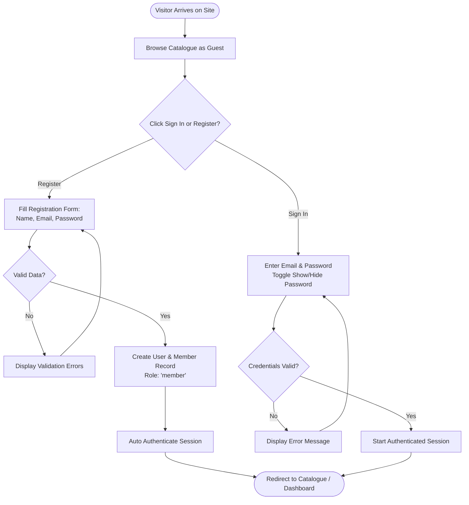
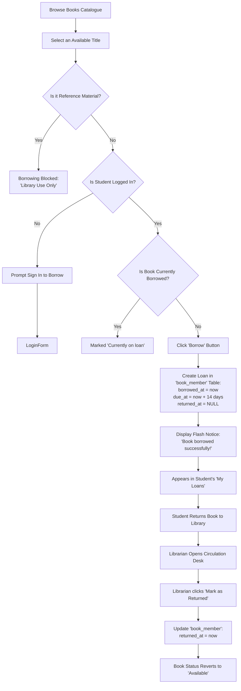
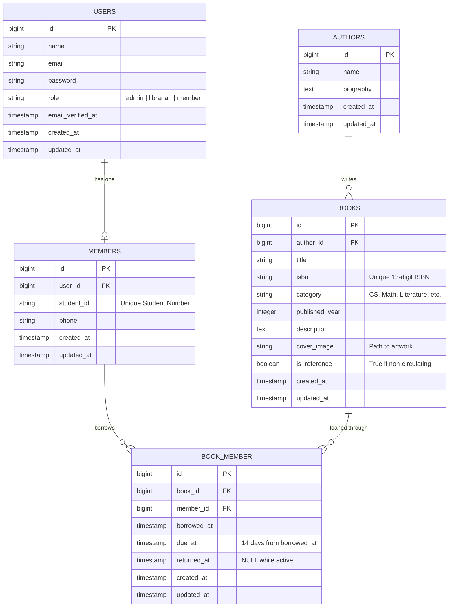

# LibraryHub: University Digital Library Management System
## Comprehensive System & Academic Project Documentation

---

**Project Title:** LibraryHub — University Digital Library Management System  
**Institution:** University / College Coursework  
**Author / Developer:** Jannyca Ilaida  
**Version:** 1.0.0 (Release)  
**Date:** October 2026  
**Technology Stack:** Laravel 12 (PHP 8.5) • Tailwind CSS • Alpine.js • SQLite / MySQL • Vite  

---

## Table of Contents

1. [Executive Summary](#1-executive-summary)
2. [Project Objectives](#2-project-objectives)
   - 2.1 General Objective
   - 2.2 Specific Objectives
3. [Scope and Delimitations](#3-scope-and-delimitations)
   - 3.1 Scope of the System
   - 3.2 System Delimitations
4. [User Roles & Access Control Matrix](#4-user-roles--access-control-matrix)
5. [System Architecture & Technology Stack](#5-system-architecture--technology-stack)
6. [System Workflows & Flowcharts](#6-system-workflows--flowcharts)
   - 6.1 Student Registration & Authentication Flow
   - 6.2 Book Borrowing & Return Lifecycle
7. [Database Architecture & Entity-Relationship Model (ERD)](#7-database-architecture--entity-relationship-model-erd)
   - 7.1 Entity-Relationship Diagram (ERD)
   - 7.2 Data Dictionary (Table Schemas)
8. [Key Modules & UI/UX Design System](#8-key-modules--uiux-design-system)
   - 8.1 Modern Light Academic Editorial Aesthetic
   - 8.2 Interactive Public Book Catalogue
   - 8.3 Student Circulation & Active Loans Dashboard
   - 8.4 Staff Circulation Desk
   - 8.5 Administrator Role Management
9. [Software Quality Assurance & Testing](#9-software-quality-assurance--testing)
   - 9.1 PHPUnit Test Suite Summary (36/36 Passed)
   - 9.2 Key Test Scenarios Covered
   - 9.3 Code Style & Formatting Compliance
10. [User Manual & Step-by-Step Walkthrough](#10-user-manual--step-by-step-walkthrough)
11. [Installation, Setup & Deployment Guide](#11-installation-setup--deployment-guide)
12. [Default Credentials & Demonstration Accounts](#12-default-credentials--demonstration-accounts)

---

## 1. Executive Summary

**LibraryHub** is a web-based University Digital Library Management System engineered to modernize the physical and digital book lending processes in academic institutions. Developed with **Laravel 12** and **PHP 8.5**, the platform provides a modern, fast, and accessible interface for students, faculty, library staff, and system administrators.

Traditional campus libraries often face issues such as misplaced inventory, cumbersome manual checkout logs, lack of clear visibility into book availability, and fragmented student borrowing records. LibraryHub resolves these bottlenecks by offering real-time book status tracking, an intuitive visual catalogue with subject categorization, a self-service 14-day borrowing pipeline, an integrated circulation desk for processing returns, and role-based access control.

---

## 2. Project Objectives

### 2.1 General Objective
To design, develop, and evaluate a secure, responsive, and user-centric University Digital Library Management System that automates book cataloguing, student book borrowing, loan tracking, and staff circulation desk operations.

### 2.2 Specific Objectives
1. **Automate Book Inventory & Availability**: Provide real-time categorization and status tracking for all titles (`Available`, `Borrowed / On Loan`, `Reference Only`).
2. **Streamline Self-Service Borrowing**: Allow registered students to instantly borrow available titles with an automatic 14-day loan schedule and status updating.
3. **Safeguard Reference Materials**: Enforce a strict policy preventing non-circulating reference materials from being loaned off-premises.
4. **Empower Library Staff**: Provide librarians with an integrated Circulation Desk interface to monitor active borrowings and process book returns with a single click.
5. **Implement Robust Role-Based Access Control (RBAC)**: Ensure distinct user privilege tiers for Guests, Students/Members, Librarians, and System Administrators.
6. **Deliver an Academic Aesthetic**: Create a clean, distraction-free "Light Academic" user experience featuring soft purple and indigo gradients, high-contrast typography, and single-screen compact forms.

---

## 3. Scope and Delimitations

### 3.1 Scope of the System
- **Public & Guest Access**:
  - Full access to the public book catalogue.
  - Multi-category filtering across 7 academic disciplines (Computer Science, Mathematics, Physics, Biology, Economics, Literature, etc.).
  - Real-time live search by title, author name, and ISBN.
  - Interactive Quick View modal displaying book synopsis, author, published year, and category details.
  - Responsive registration and authentication interfaces.
- **Student / Member Module**:
  - Personal student dashboard with active loan statistics.
  - One-click book borrowing with automated 14-day due date computation.
  - Personal loan history log displaying borrowed titles, due dates, and return statuses.
- **Librarian / Staff Module**:
  - Dedicated Circulation Desk (`/desk`) displaying all active university borrowings.
  - Single-click book return verification (`returned_at` timestamping).
  - Complete Book CRUD (Create, Read, Update, Delete) management.
- **Administrator Module**:
  - Comprehensive user management panel (`/admin/users`).
  - Real-time role reassignment (`admin`, `librarian`, `member`).
  - Full system supervisory oversight.

### 3.2 System Delimitations
- The system manages internal campus book loans; it does not process monetary overdue fines or integrate third-party payment gateways.
- Physical barcode or RFID hardware scanner integration is outside the current scope; circulation operations are handled via system records and ISBN identifiers.
- Multi-campus physical freight tracking is not included; the system is designed for single-campus university deployment.

---

## 4. User Roles & Access Control Matrix

The system implements strict Laravel middleware and policy boundaries across four distinct user tiers:

| Feature / Action | Guest (Visitor) | Student (Member) | Librarian (Staff) | Administrator |
| :--- | :---: | :---: | :---: | :---: |
| **Browse Catalogue & Search** | ✅ Yes | ✅ Yes | ✅ Yes | ✅ Yes |
| **Quick View Book Synopsis** | ✅ Yes | ✅ Yes | ✅ Yes | ✅ Yes |
| **Filter by Subject / Availability** | ✅ Yes | ✅ Yes | ✅ Yes | ✅ Yes |
| **Student Account Registration** | ✅ Yes | ❌ (Already registered) | ❌ | ❌ |
| **Self-Service Book Borrowing** | ❌ (Prompts Login) | ✅ Yes (14-day loan) | ✅ Yes | ✅ Yes |
| **View Personal Active Loans** | ❌ | ✅ Yes (`/my/loans`) | ✅ Yes | ✅ Yes |
| **Access Circulation Desk** | ❌ | ❌ | ✅ Yes (`/desk`) | ✅ Yes (`/desk`) |
| **Process Book Returns** | ❌ | ❌ | ✅ Yes | ✅ Yes |
| **Create / Edit / Delete Books** | ❌ | ❌ | ✅ Yes | ✅ Yes |
| **Manage User Roles & Permissions**| ❌ | ❌ | ❌ | ✅ Yes (`/admin/users`)|

---

## 5. System Architecture & Technology Stack

The application is built on the industry-standard **Model-View-Controller (MVC)** architectural pattern provided by Laravel 12:

```
[ Browser / Client ] 
        │
        ▼ (HTTP Request / HTTPS)
[ Laravel Routing & Middleware (Auth, Role Verification) ]
        │
        ▼
[ Controllers (BookController, LoanController, AdminUserController) ]
        │
        ├──► [ Eloquent Models (User, Member, Book, Author) ] ◄──► [ SQLite / MySQL DB ]
        │
        ▼
[ Blade View Layer (Tailwind CSS 3, Alpine.js Components, Vite Bundling) ]
        │
        ▼
[ Rendered High-Performance HTML Response ]
```

### Technology Breakdown:
- **Backend Framework:** Laravel 12.x
- **Runtime Environment:** PHP 8.5 (Strict typing, constructor promotion, null-safe operators)
- **Frontend Styling:** Tailwind CSS 3.x (Utility-first responsive design, custom palettes)
- **Client-Side Interactivity:** Alpine.js 3.x (Lightweight reactive state for modals, password toggle)
- **Asset Bundling:** Vite 8.x (Hot module replacement & tree-shaken production bundles)
- **Database Engine:** SQLite (local development & automated tests) / MySQL (production)
- **Testing Framework:** PHPUnit 11.x (Feature and Unit test suites)
- **Code Standards:** Laravel Pint (PSR-12 / Laravel code conventions)

---

## 6. System Workflows & Flowcharts

### 6.1 Student Registration & Authentication Flow



### 6.2 Book Borrowing & Return Lifecycle



---

## 7. Database Architecture & Entity-Relationship Model (ERD)

### 7.1 Entity-Relationship Diagram (ERD)



### 7.2 Data Dictionary (Table Schemas)

#### Table: `users`
| Column Name | Data Type | Nullable | Default | Description |
| :--- | :--- | :---: | :---: | :--- |
| `id` | BIGINT UNSIGNED | No | AUTO_INCREMENT | Primary Key |
| `name` | VARCHAR(255) | No | — | User's full name |
| `email` | VARCHAR(255) | No | — | Unique login email |
| `password` | VARCHAR(255) | No | — | Bcrypt hashed password |
| `role` | VARCHAR(50) | No | `'member'` | Role tier (`admin`, `librarian`, `member`) |
| `remember_token` | VARCHAR(100) | Yes | NULL | Session persistent token |
| `created_at` / `updated_at` | TIMESTAMP | Yes | NULL | Standard audit timestamps |

#### Table: `members`
| Column Name | Data Type | Nullable | Default | Description |
| :--- | :--- | :---: | :---: | :--- |
| `id` | BIGINT UNSIGNED | No | AUTO_INCREMENT | Primary Key |
| `user_id` | BIGINT UNSIGNED | No | — | Foreign key referencing `users.id` |
| `student_id` | VARCHAR(50) | Yes | NULL | Student ID number |
| `phone` | VARCHAR(50) | Yes | NULL | Contact telephone |
| `created_at` / `updated_at` | TIMESTAMP | Yes | NULL | Standard audit timestamps |

#### Table: `authors`
| Column Name | Data Type | Nullable | Default | Description |
| :--- | :--- | :---: | :---: | :--- |
| `id` | BIGINT UNSIGNED | No | AUTO_INCREMENT | Primary Key |
| `name` | VARCHAR(255) | No | — | Author's full name |
| `biography` | TEXT | Yes | NULL | Background information |
| `created_at` / `updated_at` | TIMESTAMP | Yes | NULL | Standard audit timestamps |

#### Table: `books`
| Column Name | Data Type | Nullable | Default | Description |
| :--- | :--- | :---: | :---: | :--- |
| `id` | BIGINT UNSIGNED | No | AUTO_INCREMENT | Primary Key |
| `author_id` | BIGINT UNSIGNED | No | — | Foreign key referencing `authors.id` |
| `title` | VARCHAR(255) | No | — | Book title |
| `isbn` | VARCHAR(20) | No | — | Unique ISBN-13 identifier |
| `category` | VARCHAR(100) | No | — | Academic discipline classification |
| `published_year` | INT | No | — | Year of publication |
| `description` | TEXT | Yes | NULL | Synopsis / overview |
| `cover_image` | VARCHAR(255) | Yes | NULL | Relative path to jacket cover image |
| `is_reference` | BOOLEAN | No | `false` | If true, item is restricted to library use |
| `created_at` / `updated_at` | TIMESTAMP | Yes | NULL | Standard audit timestamps |

#### Table: `book_member` (Circulation Loans Pivot)
| Column Name | Data Type | Nullable | Default | Description |
| :--- | :--- | :---: | :---: | :--- |
| `id` | BIGINT UNSIGNED | No | AUTO_INCREMENT | Primary Key |
| `book_id` | BIGINT UNSIGNED | No | — | Foreign key referencing `books.id` |
| `member_id` | BIGINT UNSIGNED | No | — | Foreign key referencing `members.id` |
| `borrowed_at` | TIMESTAMP | No | NOW() | Timestamp when book was loaned |
| `due_at` | TIMESTAMP | No | +14 Days | Due date for return |
| `returned_at` | TIMESTAMP | Yes | NULL | NULL = Active loan; Timestamp = Returned |

---

## 8. Key Modules & UI/UX Design System

### 8.1 Modern Light Academic Editorial Aesthetic
The entire UI adheres to a cohesive **Light Academic** design philosophy:
- **Palette:** Soft lavender and indigo gradients (`from-indigo-50/70 via-purple-50/50 to-pink-50/30`), crisp white cards, slate text (`text-slate-900`), and subtle border outlines (`border-slate-200/80`).
- **Typography:** High-contrast serif headlines combined with clean, modern sans-serif body copy (`Figtree`).
- **Depth & Hierarchy:** Soft ambient drop shadows (`shadow-xl shadow-indigo-950/5`) instead of harsh black borders.

### 8.2 Interactive Public Book Catalogue
- **Catalogue Hero Banner:** Displays live inventory metrics (Total Books, Available Now, Reference Volumes, Active Members) alongside a 3D book showcase.
- **Subject Filtering Tabs:** One-click horizontal filter pills covering Computer Science, Mathematics, Physics, Biology, Economics, and Literature.
- **Single Source of Truth Badges:**
  - Status badges (`✓ Available`, `⏳ Borrowed`, `🔒 Reference`) are prominently placed on top of the book cover.
  - The card footer contains clear action triggers (`📖 Borrow` for available titles, `Currently on loan` for active loans, and `Library Use Only` for reference books), eliminating redundant visual clutter.
- **Instant Quick View Modal:** Powered by Alpine.js for instantaneous preview of book details without navigating away from the browsing list.

### 8.3 Student Circulation & Active Loans Dashboard
- Authenticated students see their personal welcome banner indicating their checked-out count.
- Dedicated `/my/loans` page highlights due dates, countdowns, and loan status indicators.

### 8.4 Staff Circulation Desk
- Route `/desk` gives Librarians and Admins an organized circulation ledger of all checked-out books campus-wide.
- Includes borrower names, student IDs, borrow dates, and due dates.
- One-click **"Mark as Returned"** button triggers instantaneous restock of the title back into the public available inventory.

### 8.5 Administrator Role Management
- Route `/admin/users` provides role assignment dropdowns allowing the admin to promote/demote users between `member`, `librarian`, and `admin` roles in real time with flash status feedback.

---

## 9. Software Quality Assurance & Testing

### 9.1 PHPUnit Test Suite Summary (36/36 Passed)
The application is backed by an automated test suite executed via PHPUnit:

```
Tests:    36 passed (87 assertions)
Duration: 2.74 seconds
Result:   100% Passing
```

### 9.2 Key Test Scenarios Covered
1. **Authentication Tests**: Registration of new student accounts, email validation, authentication sessions, password confirmation, and remember-me functionality.
2. **Catalogue & Search Tests**: Retrieval of active books, filtering by subject categories, searching by ISBN and author name.
3. **Borrowing Policy Tests**:
   - Verification that available books can be borrowed.
   - Verification that reference books **cannot** be borrowed.
   - Verification that already-borrowed books cannot be double-checked out.
   - Verification that guest users cannot borrow without authentication.
4. **Circulation Desk Tests**:
   - Ensuring only librarians and admins can access `/desk`.
   - Ensuring normal students/members are blocked from accessing staff routes.
   - Verifying accurate recording of `returned_at` upon book check-in.
5. **Admin Authorization Tests**: Restricting `/admin/users` strictly to users with `role === 'admin'`.

### 9.3 Code Style & Formatting Compliance
All PHP source files are formatted using **Laravel Pint** (`vendor/bin/pint --format agent`), adhering strictly to PSR-12 and Laravel architectural guidelines.

---

## 10. User Manual & Step-by-Step Walkthrough

### Step 1: Browsing the Catalogue
1. Navigate to the application homepage (`http://127.0.0.1:8000/books`).
2. Use the top search bar to find books by title, author, or ISBN.
3. Click any category pill (e.g., *Computer Science*) to filter by subject.
4. Click **"Quick View →"** on any book card to preview synopsis and publication year in a popup modal.

### Step 2: Registering a Student Account
1. Click **"Register"** in the top navigation bar.
2. Enter your Full Name, Student Email, and a secure password.
3. Click the **Eye icon (👁️)** on the password field to verify your typed credentials.
4. Submit the form to automatically activate your student borrowing privileges.

### Step 3: Borrowing a Book
1. Locate any book displaying the green **`✓ Available`** status badge.
2. Click the green **`📖 Borrow`** button at the bottom of the card.
3. The system records your loan for 14 days and displays a success notification:  
   *“Book borrowed successfully! Due in 14 days.”*
4. The title immediately transitions to **`⏳ Borrowed`** / **`Currently on loan`** to prevent duplicate checkouts.

### Step 4: Tracking Loans in Personal Dashboard
1. Click **"My Active Loans"** in the navigation bar (`/my/loans`).
2. Review your currently checked-out titles along with their respective due dates.

### Step 5: Returning Books (Staff Circulation Desk)
1. Log in with a Librarian or Admin account.
2. Navigate to the **"Desk"** tab (`/desk`).
3. Locate the borrowed book record from the list.
4. Click **"Mark as Returned"**. The book is immediately restored to available status in the public catalogue.

### Step 6: Managing User Roles (System Administrator)
1. Log in with an Admin account.
2. Click **"User Management"** (`/admin/users`).
3. Select any user and choose their updated role (`Member`, `Librarian`, or `Admin`) from the dropdown.

---

## 11. Installation, Setup & Deployment Guide

To run this application locally on Windows, macOS, or Linux, follow these steps:

### Prerequisites:
- PHP 8.2 or higher (PHP 8.5 recommended) with `pdo_sqlite`, `mbstring`, `openssl`, and `tokenizer` extensions.
- Composer 2.x
- Node.js 18+ and NPM

### Setup Instructions:

```bash
# 1. Clone the repository
git clone https://github.com/jannycailaida/library-w10.git
cd library-w10

# 2. Install PHP dependencies
composer install

# 3. Install JavaScript dependencies
npm install

# 4. Configure environment file
cp .env.example .env
php artisan key:generate

# 5. Run database migrations and load sample library data
php artisan migrate --seed

# 6. Compile production frontend assets
npm run build

# 7. Start the local development web server
php artisan serve
```

The application is now accessible at **`http://127.0.0.1:8000`**.

---

## 12. Default Credentials & Demonstration Accounts

For academic evaluation, grading, and testing purposes, the database seeders provide the following pre-configured user accounts (Password for all accounts: **`password`**):

| Role | Name | Email | Password | Access Privileges |
| :--- | :--- | :--- | :--- | :--- |
| **System Admin** | Admin User | `admin@library.test` | `password` | Full system access, User Role Management, Circulation Desk, Catalogue CRUD |
| **Librarian** | Librarian User | `librarian@library.test` | `password` | Circulation Desk check-in/returns, Catalogue Book CRUD, Borrowing |
| **Student / Member** | Member User | `member@library.test` | `password` | Catalogue browsing, Self-service 14-day borrowing, Personal loan history |

---

*© 2026 LibraryHub Digital System • Developed for University Coursework Submission.*
